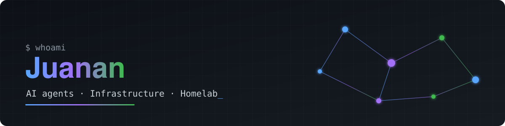
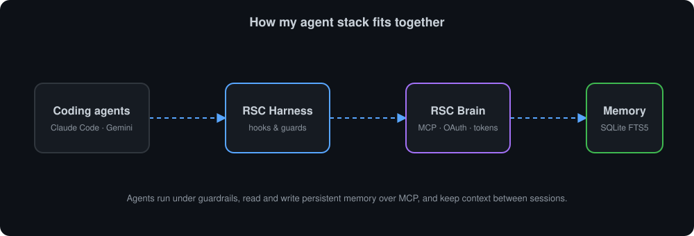

  
  
  
  
  

## 👋 About me

I build **agent systems you can trust**, **monitoring that tells the truth**, and a **homelab that runs my life**.
I like tools that are small, tested, and boring to operate.

- 🧠 Building agent workflows with persistent memory and guardrails
- 📊 Infrastructure dashboards and alerting
- 🏠 Running a self-hosted lab with proper backups and runbooks
- 🎮 Making small games in Godot on the side

## 🚀 Featured projects

| Project | What it does | Stack |
|---|---|---|
| [**RSC Brain**](https://github.com/juanan-rj/rsc-brain) | MCP server giving agents persistent memory and pinned invariants, with OAuth and per-workspace tokens | `Python` `SQLite FTS5` `OAuth 2.1` |
| **RSC Harness** *(coming soon)* | Hooks and guards for coding agents: branch and command safety, session memory | `Node.js` `Hooks` |
| [**VideojuegoGodot**](https://github.com/juanan-rj/VideojuegoGodot) | A game built with Godot | `Godot` `GDScript` |

## 🧩 How the agent stack fits together

## 🛠 Tech stack

  

## 📈 GitHub stats

  
  

